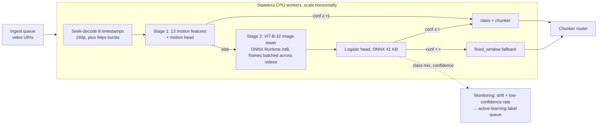

# Video-type classifier for chunker routing: CPU-only POC

**Goal.** Route every ingested video to the chunker that suits its type, cheaply enough to run on 100M videos on CPU.
**Recommendation.** Use `large@8` (ViT-B-32 on 8 frames, plus a logistic head). It reaches macro-F1 0.735 and CUS 0.843 at 891 ms/video and 351 MB.
**Lightweight alternative.** `small@4` (MobileCLIP2-S0 on 4 frames) runs at 47% of the latency with 1/7.7 of the size. It costs −0.057 macro-F1 and −0.019 CUS, both inside the 95% CI.
All numbers come from `artifacts/eval_results.json`, `artifacts/benchmark.json` and `artifacts/features/timings.json`.

## 1. Problem and taxonomy

| Class | Chunker | Typical visual signature | Typical VideoMME sources |
|---|---|---|---|
| `gameplay_animation` | shot_boundary | synthetic or flat colours, HUD overlays, hard cuts | Esports, Animation |
| `sports_broadcast` | motion_segment | fields or courts, fast pans, score bugs | Basketball, Football, Athletics |
| `vlog_egocentric` | activity | handheld shake, first-person view, one continuous scene | Daily Life, Travel, Food, Handicraft |
| `talking_head` | speaker_turn | a static framed face, low motion | News, interviews |
| `presentation_screen` | slide_change | static text or slides, long static stretches, abrupt slide changes | slide-heavy Knowledge videos |
| `cinematic_documentary` | semantic_scene | graded footage, B-roll, varied scenes | Film & TV, Documentary, Stage Play, nature |

Two criteria shaped the taxonomy. Each class changes which chunker you would run, and each class occurs in VideoMME, so it can be measured. Finer genres that share a chunker were merged. The full sub-category → class map is in `artifacts/mapping.csv`.

## 2. Data

- **Sample.** I drew a stratified 10% of VideoMME: 900 unique videos → **90** (30 short, 30 medium and 30 long), with seed 42, stratified by duration × domain (18 strata). **9** primary videos were unavailable on YouTube, and each was replaced by a spare from the same stratum (`replaced` column in `sample.csv`). Video only, downloaded at ≤240p: about 1.1 GB.
- **Labels.** `label_auto` comes from the sub-category map. `label_final` comes from a manual review of a 4×4 contact sheet (16 frames) for every video, with every change logged in `label_overrides.csv`. The review changed **27/90** labels, so agreement between the auto and reviewed labels is **0.70**.
- **Final class support.** cinematic 35, vlog 22, gameplay 11, talking_head 9, sports 8, presentation 5. Every class has at least 5 videos, so `small_classes` is empty, but presentation is at that floor.

## 3. Feature engineering

- **Sampling.** I take 16 timestamps spread uniformly over the whole video, skipping the first and last 5%, and seek-decode only those (23.4 ms per timestamp at 240p). Video type is a property of the whole video, so uniform coverage beats sampling dense clips. Seeking also keeps decode cost independent of video length. The 4- and 8-frame configs use evenly spaced subsets of these 16 timestamps.
- **13 motion and appearance features** (3.4 ms per timestamp). Each timestamp also gets a burst of 8 grayscale 64×64 frames, 0.25 s apart. From these bursts I compute:
  - motion energy (mean, std and max);
  - hard-cut rate per second;
  - camera shake (mean and std of the `phaseCorrelate` shift);
  - static fraction;
  - scene diversity;
  - brightness (mean and std), saturation, edge density and colourfulness.

  A per-frame image encoder sees one still frame at a time, so it cannot observe motion, cuts or handheld shake. These signals were meant to separate vlogs from cinematic footage and slides from talking heads.
- **Frozen encoders.** I use the image towers of **MobileCLIP2-S0 / dfndr2b** (11.4M parameters, 45 MB in fp32) and **ViT-B-32 / laion2b_s34b_b79k** (87.8M parameters, 351 MB). Both produce 512-d embeddings, which I L2-normalise and pool as **mean ⊕ std** over frames (1024-d). The std term captures visual variety. The head is StandardScaler followed by a class-balanced multinomial logistic regression: 33 KB of parameters, exported to ONNX (41.5 KB file).

## 4. Results

The protocol is stratified 5-fold cross-validation, repeated 5 times. Each figure is the mean with a 95% bootstrap CI (200 resamples). Latency is the sum of the per-component times measured on the featurization machine.


| Config | macro-F1 [95% CI] | CUS [95% CI] | ms/video | MB (fp32) |
|---|---|---|---|---|
| motion@4 / @16 | 0.205 [0.147, 0.282] / 0.247 [0.162, 0.313] | 0.542 / 0.531 | 108 / 428 | 0.0004 |
| **small@4** (lightweight) | 0.677 [0.550, 0.756] | 0.824 [0.767, 0.871] | **420** | **45.5** |
| small+motion@4 | 0.700 [0.587, 0.768] | 0.832 [0.772, 0.878] | 434 | 45.5 |
| large@4 | 0.687 [0.549, 0.773] | 0.833 [0.775, 0.885] | 446 | 351.4 |
| small@8 | 0.634 [0.508, 0.719] | 0.790 [0.724, 0.841] | 839 | 45.5 |
| **large@8** (operating point) | **0.735 [0.622, 0.809]** | **0.843 [0.780, 0.894]** | 891 | 351.4 |
| large+motion@8 | 0.727 [0.619, 0.804] | 0.841 [0.778, 0.889] | 918 | 351.4 |
| small@16 | 0.707 [0.587, 0.772] | 0.847 [0.794, 0.890] | 1678 | 45.5 |
| large@16 (best F1) | 0.759 [0.638, 0.837] | 0.864 [0.810, 0.910] | 1782 | 351.4 |
| zero-shot small@16 / large@16 | 0.589 [0.451, 0.724] / 0.572 [0.436, 0.679] | 0.761 / 0.764 | 1677 / 1781 | 45.4 / 351.4 |

The rows not shown (small+motion@8/16 and large+motion@4/16) are in the JSON.

**Operating point.** The selection rule takes the fastest config within 0.03 macro-F1 of the best (`large@16`, 0.759), which selects **`large@8`**. τ = **0.0**, so the fallback is off. On this data no threshold reached 90% accuracy at ≥50% coverage. The risk–coverage curve is below; it uses the out-of-fold predictions of one CV repeat.

| τ | 0.0 | 0.4 | 0.5 | 0.6 | 0.7 | 0.9 |
|---|---|---|---|---|---|---|
| coverage | 1.00 | 0.89 | 0.71 | 0.59 | 0.47 | 0.23 |
| accuracy | 0.744 | 0.775 | 0.828 | 0.830 | 0.810 | 0.905 |

**Recommended alternative: `small@4`.** It runs at 420 ms instead of 891 ms and 45 MB instead of 351 MB, for −0.057 macro-F1 and −0.019 CUS, both inside the CI. Choose it if the 351 MB footprint or the latency matters more than about 2 points of routing utility. `small+motion@4` is slightly better again (0.700 / 0.832) for 14 ms more.

A caveat on latency: at batch 16 on this CPU both encoders cost roughly 55–57 ms per frame. The small config's speed comes from using **4 frames**, not from the smaller encoder; the smaller encoder's real benefit here is 7.7× less weight.

**Per-class results at the operating point.** These come from the out-of-fold predictions of one CV repeat (rows are true labels, columns are predictions):

| true \ pred | G | S | V | T | P | C | F1 |
|---|---|---|---|---|---|---|---|
| G gameplay (11) | **10** | 0 | 0 | 0 | 1 | 0 | 0.870 |
| S sports (8) | 0 | **8** | 0 | 0 | 0 | 0 | 0.941 |
| V vlog (22) | 0 | 0 | **16** | 1 | 0 | 5 | 0.711 |
| T talking_head (9) | 0 | 0 | 2 | **3** | 0 | 4 | 0.462 |
| P presentation (5) | 0 | 0 | 0 | 0 | **4** | 1 | 0.727 |
| C cinematic (35) | 2 | 1 | 5 | 0 | 1 | **26** | 0.732 |

The errors fall where you would expect: vlog ↔ cinematic, and talking_head → cinematic or vlog. Plausibly because interviews shot on location look like B-roll.

**What else the sweep showed:**
- **Training the head matters.** Zero-shot CLIP prompts reach 0.57–0.59 macro-F1 against 0.735 for the trained 33 KB head.
- **Labels matter more than the encoder.** Training on the proxy `label_auto` drops the operating point to 0.550 [0.440, 0.634] macro-F1.
- **Motion features are weak.** On their own they reach 0.21–0.25 macro-F1. On top of embeddings they add at most +0.023 (at @4) and sometimes −0.011, always within the CI.

**Bayes rule vs argmax.** The expected-utility decision rule changes CUS by +0.0042 at `large@8` (0.843 → 0.847) and by between −0.003 and +0.004 across all embedding configs. That is negligible, for two reasons: U is strongly diagonal-dominant, and the head is confident. Production therefore uses argmax.

## 5. Custom metric: Chunking Utility Score (CUS)

Macro-F1 treats every mistake as equally bad. A router's mistakes are not: sending a talking head to the slide chunker still leaves a transcript-aligned chunker, while sending it to the motion chunker does not. CUS measures this.

- **U[true, pred]** is the fraction of downstream chunking quality kept when the router predicts `pred` for a video of class `true` (`artifacts/utility.csv`).
- **CUS = mean over videos of U[yᵢ, ŷᵢ]**. A perfect router scores 1.
- **Decision rule.** Under CUS, the decision that maximises expected utility is ŷ = argmaxₖ Σⱼ p(j)·U[j,k].

| U | G | S | V | T | P | C |
|---|---|---|---|---|---|---|
| G | 1.0 | 0.7 | 0.3 | 0.2 | 0.2 | 0.4 |
| S | 0.7 | 1.0 | 0.3 | 0.2 | 0.2 | 0.3 |
| V | 0.3 | 0.3 | 1.0 | 0.3 | 0.2 | 0.5 |
| T | 0.2 | 0.2 | 0.3 | 1.0 | 0.6 | 0.3 |
| P | 0.2 | 0.2 | 0.2 | 0.6 | 1.0 | 0.2 |
| C | 0.4 | 0.3 | 0.5 | 0.3 | 0.2 | 1.0 |

**U is an assumption, not a measurement.** The next step is to calibrate it: run each chunker on each class and measure retrieval recall@k on VideoMME questions, then set U[j,k] = recall(chunker k on class j) / recall(chunker j on class j).

## 6. Deployment (on paper)



- **The cascade gives no saving today.** Simulating it on the out-of-fold predictions found no τ1 at which motion-only matched stage-2 accuracy, so the stage-1 stop fraction is **0.0** and the expected cost is **891 ms/video**, the same as running stage 2 alone. Stage 1 stays as a hook for a future, stronger cheap model.
- **Cost at 100M videos.** At 891 ms × 1e8, the job takes **≈24,758 CPU-hours**, counted as worker-hours (one pipeline process on the benchmark machine). A 24 h turnaround needs **1,032 workers**.
  - The measured end-to-end batch-32 throughput is better: 1.68 videos/s, or 595 ms/video. At that rate the job takes **16,521 worker-hours**, and a 24 h turnaround needs **689 workers**.
  - With `small@4` (420 ms) the job takes 11,669 worker-hours, and a 24 h turnaround needs 487 workers.
  - Int8 quantization is planned but was not measured.
- **Measured end-to-end latency** (batch 1, 3 demo clips): p50 598.8 ms and p95 612.5 ms. The median split is decode 168 ms, encoder 430 ms and head 0.18 ms.
- **Monitoring.** Track the predicted class mix against the 90-video prior (drift) and the share of videos with confidence < 0.5 (29% in this evaluation). Send that low-confidence slice to an active-learning labeling queue.

## 7. Limitations and next steps

- **The sample is small.** With n = 90, the CIs are about ±0.1 wide and most differences between encoder configs fall inside them. Presentation has only 5 videos and talking_head has 9, so their F1 scores are noisy.
- **Labels are proxies.** They are sub-category defaults corrected by one contact-sheet review: 27 changes, made by Claude and confirmed by the user. No second annotator was used.
- **U is assumed** (see §5).
- **Thresholds were tuned on the data they are scored on.** τ, τ1 and the operating-point rule were picked on the same out-of-fold predictions they are reported on, so those numbers are slightly optimistic.
- **There is no audio.** Talking_head vs presentation and vlog vs cinematic are where the errors are. Next steps are CLAP or ASR-density features, and higher-fps shake features.
- **Latency comes from one machine**: Windows 11, AMD64 Family 25 Model 80 (AuthenticAMD), 16 logical cores, CPU only. Re-measure it with `benchmark`.

## How to run and reproduce

**Grader run** (`run.yaml`; takes about 10 minutes plus the pip install and needs no video download):

```bash
pip install -r requirements.txt
python src/main.py fetch-encoder       # production encoder weights (ViT-B-32)
python src/main.py evaluate            # full sweep from committed features -> eval_results.json, pareto.png
python src/main.py predict samples/    # 3 demo clips -> JSON per video
python src/main.py benchmark samples/  # batch-1 / batch-32 timings -> benchmark.json
python -m pytest -q
```

**Full rebuild from YouTube** (`featurize` resolves and downloads both encoders itself):

```bash
python src/main.py sample        # stratified 90 + spares -> artifacts/sample.csv
python src/main.py download      # yt-dlp, <=240p video-only -> data/videos/
python src/main.py extract       # 16 frames + motion bursts per video
python src/main.py label-sheets  # 4x4 contact sheets -> data/sheets/
#   manual step: review the sheets, record corrections in artifacts/label_overrides.csv
python src/main.py labels        # labels.csv = mapping + overrides
python src/main.py featurize     # motion features + small/large embeddings -> artifacts/features/
python src/main.py evaluate
python src/main.py export        # production head -> artifacts/models/head_large_8.onnx
```
